# HMM-Net: Hierarchical Multimodal Multi-label Network for Harmful Video Classification

The explosive growth of short-form video platforms (like TikTok and Reels) brings massive content moderation challenges. A harmful video might hide behind normal visuals while the audio contains offensive language, or the video might seem safe but the on-screen text (OCR) is clickbait or a scam. Relying on a single modality (only vision or only audio) is insufficient.

**HMM-Net** provides a comprehensive solution: A **Multimodal** and **Hierarchical** machine learning system. It acts as a "gatekeeper" to detect harmful videos and accurately classifies which of the 7 specific policies the video violates.

---

## 📂 Project Structure

The entire pipeline, from raw data processing to model training, is systematically organized in the `src/` directory:

```bash
src/
├── pre-processing/
│   ├── asr/          # Speech-to-text (Whisper), LLM Normalize & Embeddings Extraction
│   ├── audio/        # Ambient audio feature extraction (CLAP)
│   ├── ocr/          # On-screen text extraction (PaddleOCR), LLM Normalize & Embeddings
│   ├── video/        # Frame sampling, Scene Description (Gemma 4), SigLIP2 & PhoBERT Embeddings
│   ├── dataloader/   # Dataset splitting (Iterative Stratification)
│   └── eda/          # Exploratory Data Analysis and Statistics
└── training/
    └── pipeline-training-hierarchical.ipynb  # End-to-end Cascade training notebook
```

---

## ⚙️ Pre-processing Pipeline

The raw dataset (6,285 videos) undergoes independent processing across 4 modalities to extract maximum context:

### 1. 👁️ Vision (`src/pre-processing/video`)
Visuals are core but can be noisy without context.
- **Extract Frames:** Sample 8 representative frames per video.
- **Scene Description:** Use a Vision-Language Model (Gemma 4) to describe the scene in text, helping the model understand "actions" rather than just static pixels.
- **Embedding:** Generate feature vectors using **SigLIP2** (for images) and **PhoBERT** (for text descriptions), followed by Concat.

### 2. 🗣️ ASR (`src/pre-processing/asr`)
- **Transcribe:** Use ChunkFormer to transcribe all dialogues.
- **LLM Normalize & Priors:** Use an LLM to clean the text and act as an early moderator to generate prior predictions (Tabular Priors) for the 7 harmful labels.
- **Sliding Window Embedding:** Long transcripts exceed the model's token limit. We apply a **Sliding Window** mechanism combined with **PhoBERT** to preserve semantic meaning.

### 3. 📝 OCR (`src/pre-processing/ocr`)
- **Extract:** Scan frames using PaddleOCR to detect and VietOCR to recognize text.
- **Clean & Normalize:** OCR data is often messy. We use an LLM to group text, fix typos, and generate 5 Auxiliary Priors.
- **Embedding:** Extract features using **PhoBERT**.

### 4. 🎵 Ambient Audio (`src/pre-processing/audio`)
Background sounds (explosions, screaming, or specific music) provide excellent context.
- Preprocessing: Use Demucs to separate audio into No_Vocals
- Use the **CLAP** (Contrastive Language-Audio Pretraining) model to embed audio signals into a 512-dimensional vector.

### 5. 🗂️ Data Splitting (`src/pre-processing/dataloader`)
- We use the `IterativeStratification` algorithm to create a 70/15/15 (Train/Val/Test) split. This ensures that extremely rare labels (like `information_harm`) are evenly distributed without causing data leakage.

---

## Dataset Statistics and Exploratory Data Analysis (EDA)

Comprehensive exploratory data analysis is implemented in [`src/eda/dataset_statistics.ipynb`](src/eda/dataset_statistics.ipynb), analyzing 6,285 videos and ground-truth annotations across `data/label-origin.csv` and `data/video_parts/` (`part_01` to `part_13`).

### 1. Label Distribution and Class Imbalance

The dataset consists of 6,285 samples:
- **Normal Content**: 1,620 videos (25.78%)
- **Harmful Content**: 4,665 videos (74.22%)

Among the 7 fine-grained harm categories:
- `addictive_harm`: 1,142 samples (18.17%)
- `physical_harm`: 1,081 samples (17.20%)
- `psychological_harm`: 1,003 samples (15.96%)
- `clickbait_harm`: 828 samples (13.17%)
- `hate_harassment_harm`: 540 samples (8.59%)
- `sexual_harm`: 533 samples (8.48%)
- `information_harm`: 269 samples (4.28%) - rare class

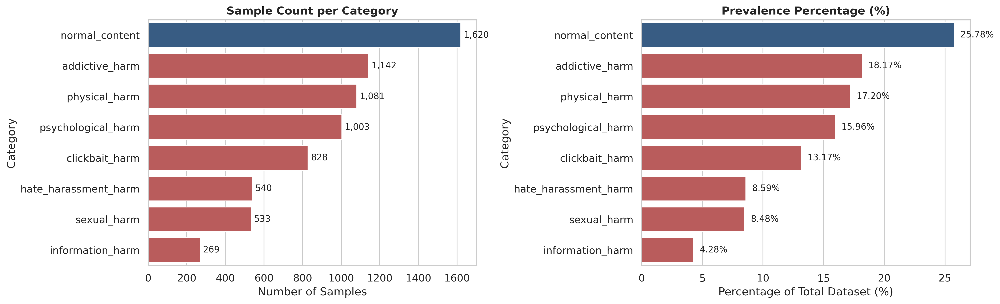

### 2. Multi-label Cardinality and Co-occurrence

- **0 labels (Normal Content)**: 1,620 videos (25.8%)
- **1 harm label**: 3,937 videos (62.6%)
- **2 harm labels**: 725 videos (11.5%)
- **3 harm labels**: 3 videos (0.05%)

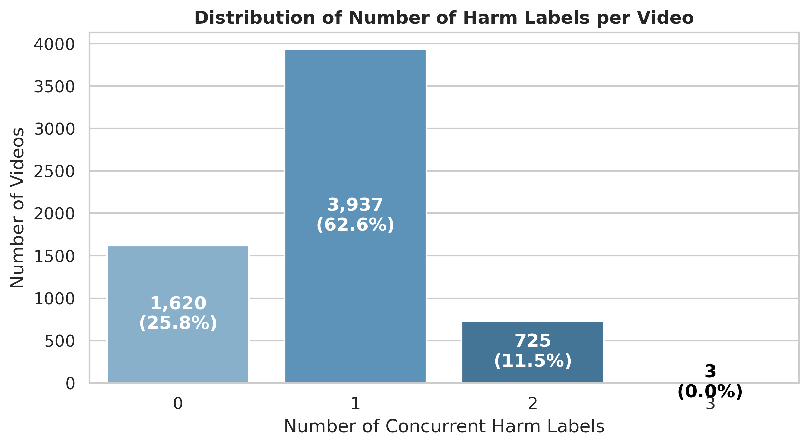

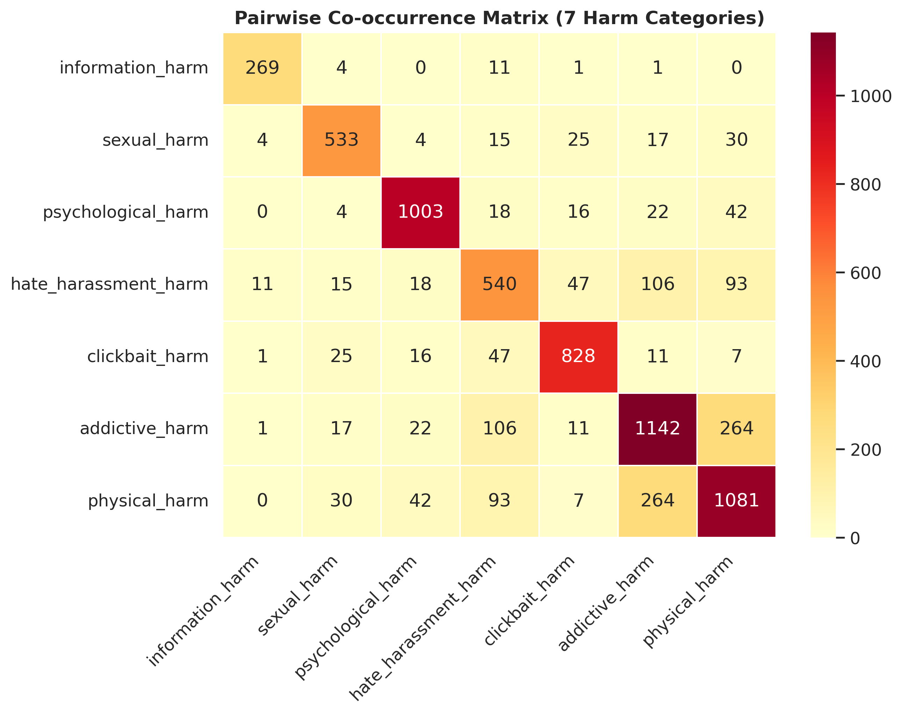

### 3. Video Technical Metadata

Extracted from 6,285 videos cached in `data/video_metadata.csv`:
- **Durations**: Median 29.40s, Mean 46.65s (Min: 1.04s, 75th percentile: 59.98s, Max: 298.30s). All videos are under 300s.
- **Aspect Ratios**: 91.87% vertical format (9:16, e.g. 720x1280 or 1080x1920), matching short-form video standards.
- **File Integrity**: 6,285 / 6,285 (100%) videos successfully verified without container corruption.

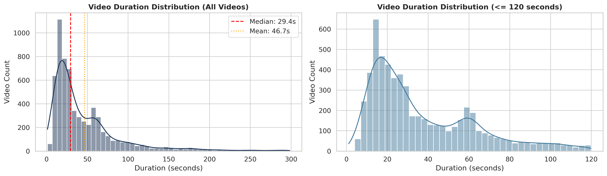

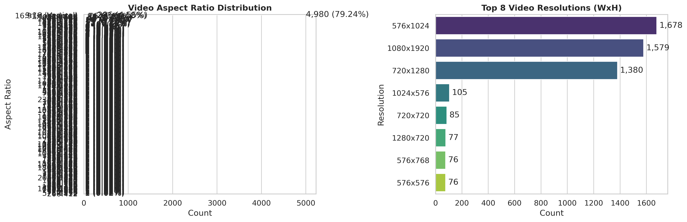

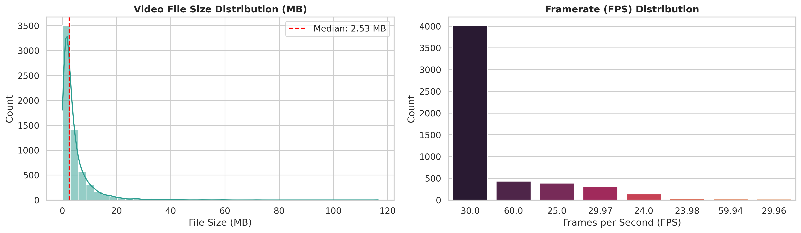

---

## 🏗️ Architecture & Training

The entire process converges in `src/training/pipeline-training-hierarchical.ipynb`. We apply a coarse-to-fine strategy using a **Cascade Pipeline**.

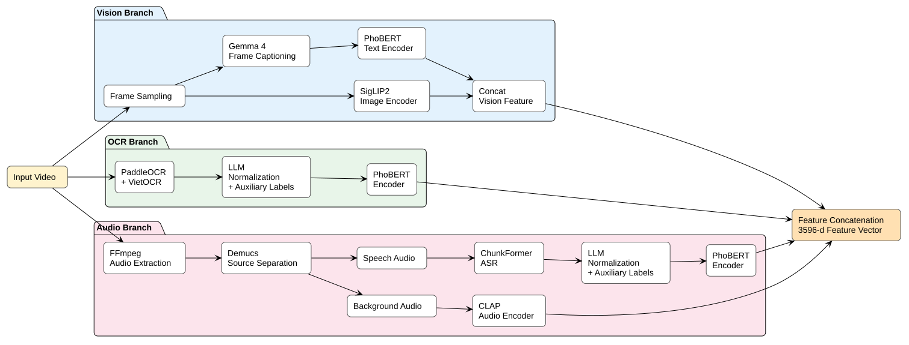
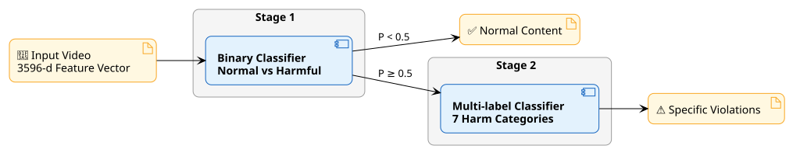


### Training Strategy (Warm-start)
*   **Stage 1 (Harm Detection):** Uses `BCEWithLogitsLoss` with `pos_weight` to handle the Normal vs Harmful class imbalance. We apply a **Dropout of 0.5** to force the model to learn robust features and completely eliminate overfitting.
*   **Stage 2 (Specific Violation Classification):** Uses a **Warm-start** approach. The trained weights from Stage 1 are loaded. The MLP body is frozen for the first 2 epochs to let the new 7-neuron Head adapt. Afterward, the entire network is unfrozen with a smaller Learning Rate for fine-tuning.

---

## 📈 Experimental Results

The hierarchical architecture results in an extremely stable and robust system.

### 1. Stage 1: Reliable Gatekeeper
Thanks to high regularization (Dropout 0.5), the learning curve is smooth with no overfitting.
*   **Val ROC-AUC:** Reached **0.958** at Epoch 15.
*   Achieved **93.1%** Recall (missing only 48 harmful videos) and **95.7%** Precision, ensuring that almost no safe videos were wrongly passed to Stage 2.

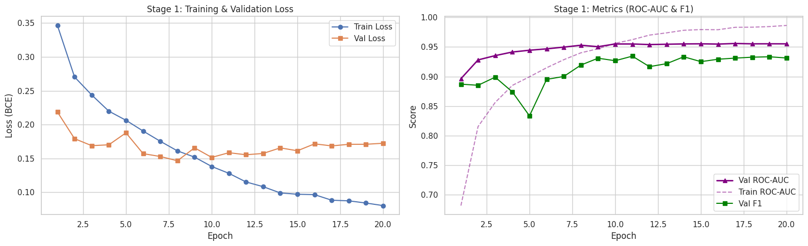
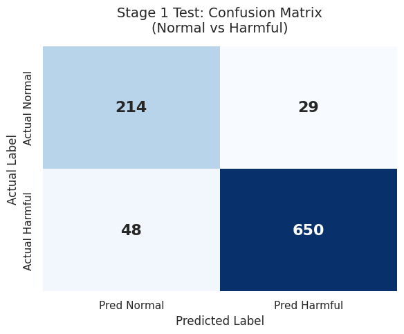


### 2. Stage 2 Evolution
By warm-starting from Stage 1, Stage 2 converges rapidly. Right after unfreezing at epoch 3, the F1-Macro jumps vertically from 0.3 to almost 0.7 and smoothly plateaus at 0.85.

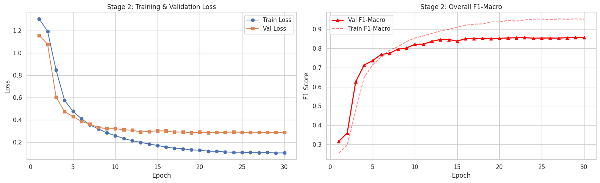
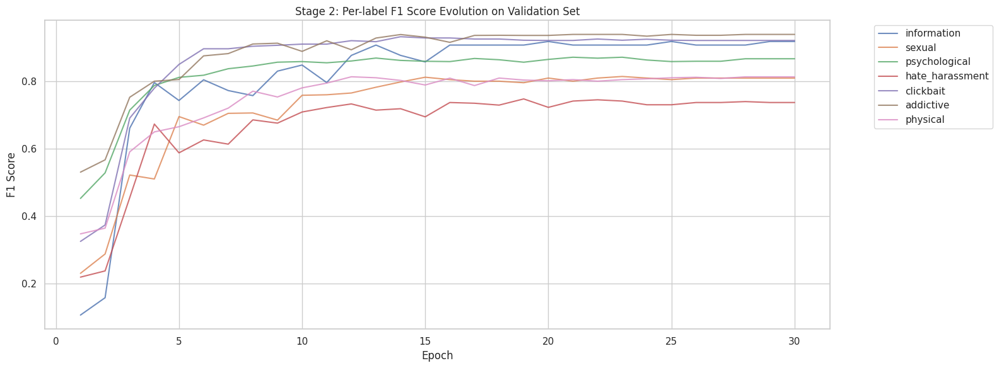

### 3. End-to-End Cascade Evaluation
When connecting the full pipeline (Video -> Stage 1 -> Stage 2) and evaluating on the unseen Test Set, the system achieves impressive scores:

> **F1-Macro: 0.816** | **F1-Micro: 0.826**

Per-label F1 Performance:
- 🥇 `clickbait_harm` (0.934) & `addictive_harm` (0.932): Top performance due to seamless integration between vision (gameplay screens) and text (OCR keywords).
- 🥈 `psychological_harm` (0.804) & `physical_harm` (0.795): Excellent handling of violent or dark visuals, heavily compensated by Scene Description and Audio.
- 🥉 `information_harm` (0.741) & `sexual_harm` (0.708): The hardest labels (requiring fact-checking or distinguishing between fashion and explicit content) still achieved highly acceptable scores for production environments.

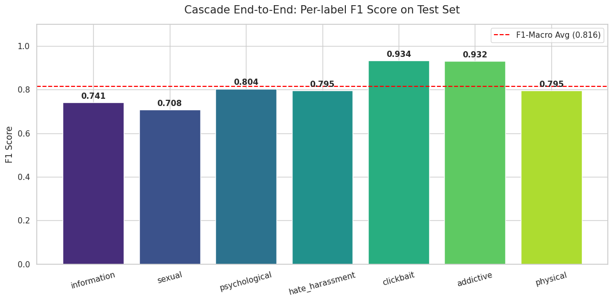

---
*Project: Hierarchical Multimodal Multi-label Classification*
